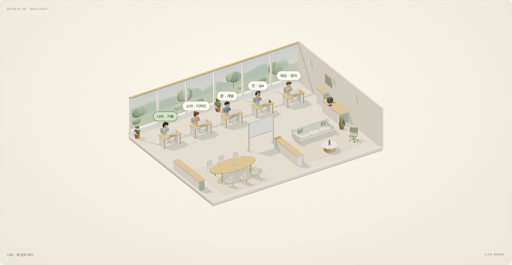

<div align="center">

# 🪴 AI Simu Desk

**업무 흐름을 눈으로 확인하는, 다섯 동료의 3D 협업 워크스페이스**

요청을 맡기고, 진행을 살펴보고, 결과를 이어서 정리하는 작은 스튜디오.


[어떤 프로젝트인가요?](#about) · [주요 기능](#features) · [다섯 동료](#team) · [실행하기](#quick-start)

</div>



<sub>다섯 동료와 작업·회의·휴식 공간을 담은 실제 로컬 실행 화면입니다. 사용자 데이터와 분리된 임시 게스트 공간에서 촬영했습니다. [캡처 정보](docs/images/README.md)</sub>

> [!IMPORTANT]
> **실제 기능은 로그인·업무 관리·승인·저장·협업이고, 답변 생성은 규칙 기반 Fake AI입니다.**
> 외부 언어 모델이나 검색 API를 호출하지 않으며, 독립된 AI 에이전트 5개가 실제 업무를 수행하는 서비스는 아닙니다.

<a id="about"></a>
## 🧭 어떤 프로젝트인가요?

AI Simu Desk는 **3D 사무실과 업무 관리 화면을 결합한 로컬 웹 애플리케이션**입니다. 기획·디자인·개발·QA·정리 역할의 동료를 선택해 요청하고, 승인부터 완료까지의 흐름과 저장된 답변을 한 공간에서 확인할 수 있습니다.

| 업무를 맡기는 공간 | 함께 확인하는 공간 | 살아 있는 3D 사무실 |
| :--- | :--- | :--- |
| 요청·승인·진행·완료·재시도 | 개인/공동 작업 공간, 댓글과 알림 | 동료별 업무 습관, 대화와 휴식 |
| 템플릿과 공통 조건으로 시작 | 결과 요약·표 정리·인계·기록 검색 | 시점·조명·배속·일시정지 조절 |

**현재 제공 형태는 로컬 실행입니다.** 계정과 업무 데이터는 실행한 컴퓨터의 서버 DB에 저장됩니다. 공개 호스팅 주소는 제공하지 않습니다.

<a id="features"></a>
## ✨ 주요 기능

### 🗂️ 요청부터 결과까지 한 흐름으로

- 동료와 업무 템플릿을 선택하고, 프로젝트의 공통 조건을 요청에 넣습니다.
- 실행 전 확인이 필요한 요청은 승인·거절을 거쳐 진행합니다.
- 진행 상태를 확인하고 업무를 취소하거나, 실패한 실행을 다시 시도합니다.
- 완료한 답변을 3줄 요약·표로 정리하고, 다른 동료에게 인계를 검토합니다.
- 원본과 수정 결과를 비교하고, 요청·답변·담당·상태로 과거 기록을 찾습니다.

### 🤝 같은 공간에서 진행 상황 공유

개인 공간 외에 공동 작업 공간을 만들고 초대 코드로 참여할 수 있습니다. **소유자·업무 참여·보기 전용** 권한을 구분하며, 댓글·알림·온라인 상태와 업무 결과를 함께 확인합니다.

계정으로 저장한 업무와 답변은 새로고침·재로그인 후에도 이어집니다. 공동 3D 장면을 송신해 같은 동료의 움직임을 관찰하는 기능도 제공합니다.

### ☀️ 각자의 속도로 움직이는 사무실

창가의 다섯 작업 자리, 회의 테이블, 소파와 커피 공간이 하나의 3D 장면에 담겨 있습니다. 동료들은 역할에 따라 메모하고, 스케치하고, 입력하고, 문서를 확인합니다. 대화·컵 사용·휴식 후에는 업무 자리로 돌아옵니다.

동료 가까이 보기, 카메라 회전·확대, 낮/저녁 조명, 화질·배속·정지를 조절할 수 있습니다. **시각 동작의 배속은 실제 업무·저장·인증 시간을 바꾸지 않습니다.**

<a id="team"></a>
## 👥 다섯 동료를 만나보세요

| 동료 | 역할 | 사무실에서 보이는 습관 |
| :--- | :--- | :--- |
| 🌿 **나라** | 기획 | 우선순위를 짧게 메모하고, 보드를 보며 생각 정리 |
| 🎨 **소라** | 디자인 | 큰 곡선 스케치, 색상 견본 비교, 열린 손으로 설명 |
| 💻 **준** | 개발 | 짧은 입력과 긴 화면 확인, 마우스 탐색과 안경 정돈 |
| ✅ **민** | QA | 항목 대조, 멈춰서 재확인, 체크리스트 확정 |
| 📄 **레오** | 정리 | 문서 가장자리 정렬, 긴 문장 읽기, 항목별 분류 |

다섯 역할의 협업 시연은 기획 → 디자인 → 개발 → QA → 정리 순서의 **모의 업무 흐름**입니다. 캐릭터 동작은 절차형 애니메이션이며 실제 사람의 움직임이나 AI의 내부 추론을 보여주는 것은 아닙니다.

<a id="quick-start"></a>
## 🚀 내 컴퓨터에서 실행하기

**준비물:** Node.js **22.x**, npm, WebGL을 지원하는 데스크톱 브라우저.

```sh
git clone https://github.com/coreline-ai/ai-simu-desk.git
cd ai-simu-desk
npm ci
npm run setup:local
npm run build:product
npm start
```

**[스튜디오 열기 → http://127.0.0.1:4180](http://127.0.0.1:4180/)**

1. **게스트로 바로 시작하기** 또는 **계정 만들기**를 선택합니다.
2. 동료와 템플릿을 고르고, 함께할 업무를 입력합니다.
3. 필요하면 실행 전 승인을 선택하고 진행 상태를 확인합니다.
4. 완료한 답변을 읽고 요약·정리·인계하거나 기록에서 다시 찾습니다.

게스트는 동시에 최대 5개의 독립 공간에서 2시간 동안 체험합니다. 로그아웃하면 자리를 반환하며, 새 게스트로 접속해 이전 공간을 다시 받는 방식은 아닙니다.

<a id="안전한-로컬-빌드-교체"></a>
<details>
<summary><strong>기존 설치 업데이트·백업·복구</strong></summary>

기존 서버를 정상 종료하고 필요한 데이터를 비공개 백업한 뒤, 소스를 갱신하고 다시 빌드·실행하세요. 소스만 내려받아서는 실행 중 화면이 갱신되지 않습니다.

- `.env.local`은 서버 설정, `.data/studio`는 기본 로컬 DB 경로입니다.
- `setup:local`은 기존 설정을 보존합니다. DB·설정·백업은 Git으로 공유하지 마세요.
- 실행 중 후보 준비는 `npm run build:prepare`, 직전 산출물 선택은 `npm run build:rollback`입니다. 적용 후 서버 재시작이 필요합니다.
- 공동 장면은 모든 참여 탭을 같은 최신 번들로 갱신한 뒤 새 송신을 시작하세요.

정확한 적용·백업·복구 순서는 **[운영 핸드오프](HANDOFF.md)**를 따릅니다.

</details>

## 🧱 프로젝트 구성

| 영역 | 사용 기술 / 위치 |
| :--- | :--- |
| 3D 장면·동료 동작 | Three.js · GLB · `pilot-3d/` |
| 업무·협업 UI | HTML / CSS / JavaScript ES Modules · `product/` |
| 인증·API·업무 실행 | Node.js 22 · TypeScript · Hono · Better Auth · `server/` |
| 로컬 데이터 | PGlite + Drizzle ORM |
| 빌드 | esbuild · `scripts/` |

Docker나 외부 AI API 키 없이 로컬에서 실행할 수 있습니다. PostgreSQL/Vercel용 별도 구성도 저장소에 포함되어 있지만, 기본 실행은 로컬 PGlite이며 클라우드 연결·공개 배포가 완료된 서비스로 소개하지 않습니다.

## 📌 사용 전에 알아두세요

- **실제 생성형 AI가 아닙니다.** 답변은 입력의 키워드·조건·유형을 반영하는 규칙 기반 시뮬레이션입니다.
- 외부 LLM·검색, OAuth·이메일 인증·비밀번호 재설정·MFA, 공동 문서 동시 편집은 제공하지 않습니다.
- 캐릭터는 스타일화된 절차형 리그입니다. 일부 소품은 기존 접촉 리그를 사용하며, 모든 손가락·피부의 완전한 비관통을 보장하지 않습니다.
- 실물 모바일의 터치·발열·배터리와 모든 기기의 성능을 검증한 것은 아닙니다.
- 로컬 웹은 이 컴퓨터의 loopback 주소에서 실행됩니다. 다른 기기에서 바로 접속할 수 있는 공개 서비스가 아닙니다.

## 📖 더 알아보기

[운영·배포·복구](HANDOFF.md) · [기능별 문서](docs/) · [협업 사용 흐름](docs/collaboration-qa.md#사용-흐름과-권한) · [현재 검증 범위](docs/local-release-20261024.md)

---

<div align="center">
<sub>A little space. A thoughtful workday.</sub>
</div>
