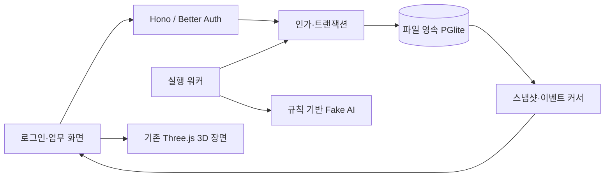
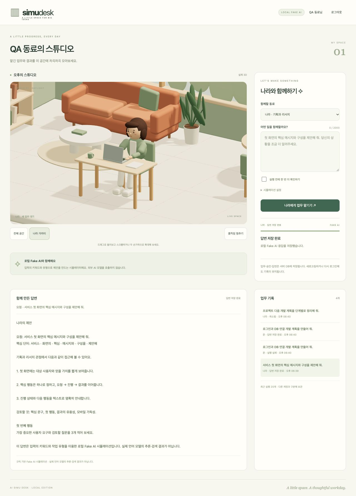
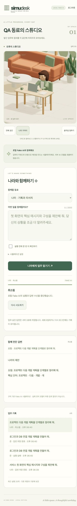

# 로그인·영속 DB·Fake AI 검증

검증일: 2026-10-19 · macOS / Node.js 22.22.2 / Codex 내장 브라우저.

## 결과와 범위

로그인 → DB 저장 → Fake AI 실행 → 3D 업무 화면 연결을 완료했다. 사용자의 “Fake AI를 만들어서 AI처럼 동작” 지시를 반영해 외부 LLM 연결을 제외했다. 계정·세션·업무·답변은 실제 서버 DB에 저장하며, 답변 생성만 규칙 기반 시뮬레이션이다. 공개 배포 완료나 운영 PostgreSQL 검증을 의미하지 않는다.

제품: [로컬 스튜디오](http://127.0.0.1:4180/) · [실행 계획](../dev-plan/implement_20261019_180900.md) · [설치/백업 방법](../README.md).

## 구현과 책임 경계

| 위치 | 책임 |
| --- | --- |
| `server/domain/` | 입력·상태 전이·AgentPort·저장 포트 계약, HTTP/ORM/Three 의존성 없음 |
| `server/db/` | Drizzle 스키마·체크섬 마이그레이션·트랜잭션·작업 공간 인가·PGlite 파일 저장 |
| `server/application/runner.ts` | 영속 큐 소비·시간 제한·진행 저장·취소·시작 시 중단 상태 정리 |
| `server/adapters/` | Better Auth와 로컬 Fake AI 구현 |
| `server/http.ts` | 세션·Origin·요청 크기·오류·API 경계 |
| `product/` | 로그인·업무·승인·답변·기록과 서버 상태를 따르는 3D 표현 |

버전은 package-lock에 고정했다. Better Auth 1.7.11, Drizzle 0.45.4, PGlite 0.5.10, Hono 4.13.13을 사용한다. 외부 AI 키·모델 다운로드·런타임 CDN이 필요하지 않다. 인증 라이브러리의 텔레메트리는 비활성화했다.

## Fake AI 제안과 구현

- 입력을 기획·개발·제품·요약·작성·일반 유형으로 분류하고 키워드를 추출한다. 나라와 준의 역할에 맞는 안내와 첫 행동을 조합한다.
- 입력 확인 → 맥락 정리 → 답변 작성 단계를 이벤트로 저장하고, 16자 단위 청크로 답변을 전달한다. 화면은 저장된 스냅샷 전체를 반영해 델타가 중복되지 않게 한다.
- 승인 필요 업무는 대기 상태에 머문다. 승인 후 실행하며 거절·취소·장애 재현·새 Run 재시도를 지원한다.
- 답변과 화면에 Fake AI임을 명시한다. 실제 추론·리서치·웹 검색·도구 실행·임의 파일 변경을 제공하지 않는다.
- 한 워커, 공간당 활성 실행 하나, 2~2000자 입력, 16,000자 출력, 30초 실행 제한을 적용한다. 기본 청크 간격은 65ms다.

실제 제공자로 전환할 때는 AgentPort 구현과 외부 부작용/비용/취소 계약을 별도 검증해야 한다. 이번 Fake 실행 통과를 실제 AI 품질 검증으로 간주하지 않는다.

## 자동 검사

`npm test` **25개 통과, 실패 0개**. TypeScript, JS 문법, 의존성 경계 검사와 제품 클라이언트/서버 빌드도 통과했다.

| 검사 | 결과 |
| --- | --- |
| 기존 2.5D 도메인·아틀라스·장면 13개, 실제 GLB·애니메이션·해제 5개 | 18개 회귀 통과 |
| Better Auth 가입·잘못된 비밀번호·실제 해시·HttpOnly/SameSite·만료·위조·로그아웃·Origin | 통과 |
| 두 계정의 공간 읽기/쓰기/이벤트/승인/취소 차단·세션 철회·잘못된 승인 JSON·16KB 초과 본문 | 통과 |
| 동시 중복 요청 8개·동일 키 본문 충돌·DB 활성 실행 유일 제약·재시작 후 멱등성 | 통과 |
| 승인/거절·취소·늦은 응답·별도 Run 재시도·이벤트 순번과 커서 | 통과 |
| 파일 재열기·실행 중단 복구·동일 DB 중복 열기 거절·마이그레이션·gzip 백업 복구 | 통과 |
| 역할/입력별 응답·청크 재조합·외부 네트워크 호출 0건·실패·시간/출력 제한 | 통과 |

실행 중 서버가 중단되면 시작 시 해당 실행을 실패로 정리한다. 취소 대기 실행은 취소로 확정하며, 완료·실패·취소된 실행은 다시 실행하지 않는다. 승인 대기는 보존하고, 아직 시작하지 않은 큐만 이어간다. 정상 종료 시 현재 실행도 중단 이유를 저장한다.

## 실제 브라우저와 서버 확인

- 실제 로그인 후 승인 필요 업무 생성 → 승인 전 답변 없음/나라 idle → 승인 후 실행을 확인했다.
- Fake AI 실행 중 나라의 `typing` 상태를 확인했다. 장애 모드의 부분 답변·실패 이유와 새 실행 재시도 완료를 확인했다.
- 취소 후 부분 답변과 취소 상태가 보존되고 늦은 응답으로 덮어쓰이지 않았다.
- 완료 Run ID와 답변 전체가 새로고침·로그아웃 후 재로그인에서도 같았다. 두 번째 계정은 다른 공간과 기록 0개를 표시했다.
- 서버 정상 종료 → 연결 안내 표시 → CLI 실제 백업 → 새 디렉터리 복구 → 서버 재시작을 수행했다. 자동 재연결 후 동일 완료 결과를 확인했고, 다시 새로고침해도 로그인·4개 기록·취소 결과가 유지됐다.
- 1280/768/390/319px 너비에서 가로 넘침이 없고 주요 실행 버튼 높이는 44px였다. 내장 브라우저 뷰포트 검사이며 실제 휴대폰·GPU 성능 측정은 아니다.
- 제한된 정적 서버에서 기존 `/demo/preview.html`과 `/pilot-3d/`가 정상 로드됐다.

증거: [브라우저 확인값](../product/evidence/browser-qa.json), [서버 스모크 결과](../product/evidence/live-smoke.json).

## 검토 중 수정한 항목

- 기존 루트 정적 서버가 서버 설정과 DB 폴더까지 제공할 수 있어 중지하고 공개 폴더만 제공하는 `serve:demos`로 교체했다. 4173·4180 양쪽에서 `.env.local`, `.data`, 서버 소스, 인코딩 경로 탈출 요청이 404였다.
- 브라우저 번들에 실제 서버 인증 비밀값이 포함되지 않음을 비교 검사했다. SQL/매개변수/스택은 API 오류 응답에 포함하지 않는다.
- 승인 본문이 `null`이나 잘못된 자료형이어도 500 대신 400을 반환하도록 보정했다.
- 응답 확인을 잃은 재시도에서도 동일 요청 키를 다시 사용하도록 화면을 보정했다. 새 실행과 동일 키/다른 본문 충돌은 DB에서 제어한다.

## 운영 전 남은 일

- 현재는 localhost HTTP, 단일 프로세스, 개인 작업 공간용이다. TLS·공개 가입 정책·메일 확인/재설정·OAuth/MFA·운영 관측·부하/보관 정책은 운영 계획에서 검증해야 한다.
- PGlite는 실제 파일에 저장되는 Postgres WASM이다. 별도 PostgreSQL 서버·복제·여러 호스트 동시 접속 성능은 검증하지 않았다. 백업은 서버를 멈춘 상태에서 수행한다.
- 준의 별도 3D 모델, 다중 사용자 공동 공간과 실제 LLM은 미구현이다. 기존 GLB는 나라 한 명과 계층형 idle/typing 동작만 포함한다.
- 자동·브라우저 검사는 구현 범위의 동작 근거이며 침투 테스트나 운영 보안 인증을 대신하지 않는다.

참고: [Better Auth Hono](https://better-auth.com/docs/integrations/hono), [Drizzle adapter](https://better-auth.com/docs/adapters/drizzle), [PGlite](https://pglite.dev/docs/).
