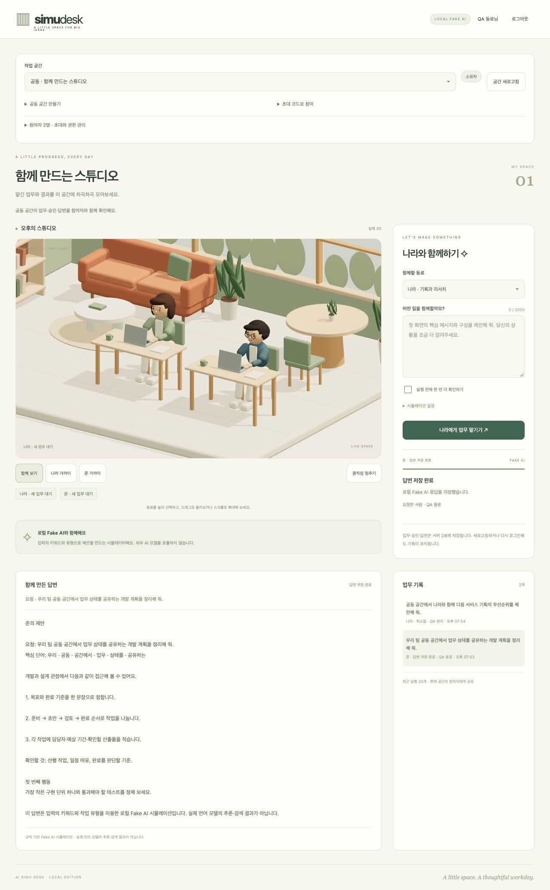
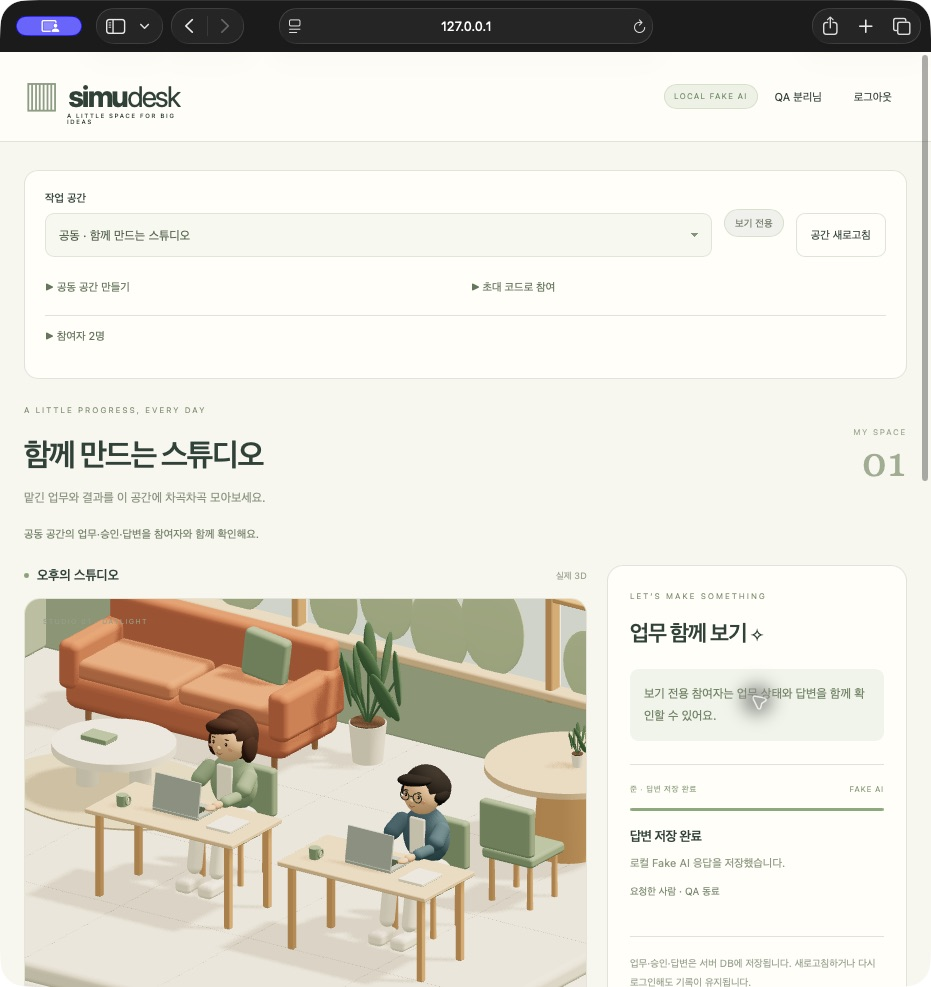

# 공동 작업 공간 협업 검증

검증일: 2026-10-19 · macOS / Node.js 22.22.2 · Codex 내장 브라우저와 별도 Safari 세션.

## 결과
여러 계정이 같은 공동 공간의 나라·준 업무, 승인, 답변, 요청자와 3D 상태를 함께 확인한다. 개인 공간을 보존하고 공동 공간 생성·초대·역할·멤버 관리와 접근 철회를 추가했다. Fake AI 방식은 유지한다.

[제품 열기](http://127.0.0.1:4180/) · [개발 계획](../dev-plan/implement_20261019_193826.md).





## 사용 흐름과 권한
1. 로그인 후 `공동 공간 만들기`에서 이름을 입력한다.
2. `참여자 · 초대와 권한 관리`에서 보기 전용 또는 업무 참여 권한을 선택하고 초대 코드를 만든다. `코드 보기`로 확인해 동료에게 전달한다. 앱이 메시지를 발송하지 않는다.
3. 다른 계정이 `초대 코드로 참여`에 코드를 입력하면 같은 공간이 열린다. 작업 공간 선택 메뉴로 개인 공간과 공동 공간을 오간다.
4. 업무·승인·답변과 두 동료의 상태를 함께 확인한다. 과거 기록을 보는 중에도 현재 업무 표시와 `현재 업무 보기`로 진행 중인 실행을 찾을 수 있다.

| 역할 | 조회 | 업무 요청 | 취소·재시도 | 승인·거절 | 초대·멤버 관리 |
| --- | --- | --- | --- | --- | --- |
| 소유자 | 가능 | 가능 | 공간의 모든 업무 | 가능 | 가능 |
| 업무 참여 | 가능 | 가능 | 본인이 요청한 실행 | 불가 | 불가 |
| 보기 전용 | 가능 | 불가 | 불가 | 불가 | 불가 |

- 권한은 UI와 별개로 모든 서버 API에서 다시 확인한다. 소유권 이전과 소유자 내보내기는 제공하지 않는다.
- 초대 코드는 192비트 난수의 1회용 코드로 1시간 뒤 만료된다. 서버에는 SHA-256 해시만 저장한다. 재발급하면 이전 미사용 코드를 폐기하며, 기존 멤버가 코드로 자기 권한을 올릴 수 없다.
- 소유자당 공동 공간 5개, 공간당 20명, 공간당 활성 업무 하나다. 이 수치는 정책 상한이며 20명의 실제 동시 부하 검증 결과가 아니다.
- 참여자 목록은 권한이 있는 계정 목록이다. 현재 온라인인 사용자 수로 표시하지 않는다.
- 진행 중인 업무는 공동 공간의 기록으로 유지된다. 요청자의 권한을 축소해도 자동 취소하지 않으며 소유자가 제어할 수 있다.

## 구현 경계
- 추가 마이그레이션 `003_collaboration.sql`로 개인/공동 공간, 역할, 초대 해시와 공간 변경 이벤트를 저장한다. 기존 마이그레이션은 수정하지 않았다.
- `server/domain/collaboration.ts`는 순수 권한 정책, `workspace-port.ts`는 공간 계약을 소유한다. `workspace-store.ts`는 공간/초대/멤버 트랜잭션, `studio-store.ts`는 권한을 적용한 업무 트랜잭션을 맡는다.
- 인가와 스냅샷·이벤트 조회를 같은 트랜잭션에서 수행한다. 승인과 멤버 변경은 버전을 확인하고, 공유 요청 키는 요청자까지 확인해 다른 사용자의 실행으로 재사용되지 않게 한다.
- 멤버 변경과 업무 변경이 같은 영속 이벤트 커서를 사용한다. 브라우저는 기본 500ms, 숨김 탭은 2초 간격으로 조회한다. 전달 지연의 상한을 보장하는 수치는 아니다.
- `product/src/workspaces.mjs`는 공간/초대/멤버 UI를, `workspace-state.mjs`는 역할별 표시와 응답 수용 정책을 소유한다. 공간 전환 시 기존 요청을 중단하고 이전 답변·멤버·코드를 지운다. 공간 ID·요청 세대·커서가 맞는 응답만 적용한다.

## 검증 결과
전체 자동 검사 **37개 통과, 실패 0개**. 기존 30개에 협업 DB 3개, 실제 인증 HTTP 1개, 순수 UI 정책 3개를 추가했다. 제품 빌드·타입·문법·의존성 경계도 통과했다.

| 확인 항목 | 근거 |
| --- | --- |
| 기존 데이터 보존 | 실제 로컬 DB를 마이그레이션 전에 비공개 gzip 덤프로 백업. 업그레이드 후 기존 6개 Run의 ID·상태·출력 지문 일치 |
| 구버전 호환 | 두 마이그레이션만 적용한 DB에서 개인 공간·세션·답변·기존 멱등 키 보존. 새 공동 공간과 미사용 초대 코드의 백업 복구 검사 |
| 경합·인가 | 8개 중복 공간 생성, 코드 동시 소비, 두 사용자의 동시 업무 요청, 중복 승인 중 한 번만 성공. 보기 전용·타인 업무 제어·자가 권한 상승·오래된 관리 버전·소유자 변경 거절 |
| 초대 | 만료·재발급·폐기·다른 사람의 중복 사용·멤버 상한, 코드 해시 저장과 이벤트 비노출 검사 |
| 여러 브라우저 | 내장 브라우저의 QA 동료(소유자)와 Safari의 QA 분리(보기 전용)가 동시에 같은 공간에 참여 |
| 준 실행 공유 | 소유자 승인 전 대기와 승인 후 실행을 두 화면에서 확인. 소유자 장면은 `nara_idle + jun_typing`, 다른 브라우저도 준 실행 상태·동일 최종 답변 전체 표시 |
| 나라 실행 공유 | 권한을 업무 참여로 변경한 두 번째 계정이 나라 업무 요청. 소유자 승인 후 `nara_typing + jun_idle`, 요청자의 취소가 양쪽에 반영 |
| 결과 일치 | 실제 서버의 독립 쿠키 세션에서 Run 배열·답변·이벤트 페이지 일치, 보기 전용 직접 POST는 403 |
| 전환·늦은 응답 | 실제 개인/공동 공간 4회 전환에서 기록·요청자·동작 분리. A→B→A 전환 후 이전 A/B 응답과 역순 커서를 거절하는 회귀 검사 |
| 권한 철회 | 내보내기 후 Safari가 자동으로 개인 공간 복귀. 스냅샷·이벤트 404, 공간 목록 제외, 기존 공동 답변 제거. 이전 링크 재접속도 개인 공간으로 복귀 |
| 복원 | 실제 서버 종료 시 두 브라우저가 연결 안내 표시. 재시작·새로고침 후 세션·공동 공간·역할·동일 Run/답변 복원. 새 코드 재초대 성공 |
| 화면 | 1280/768/390/319px에서 협업/멤버 관리 펼침·접힘 모두 가로 넘침 없음. 관리 버튼 44px, Safari 선택 상자 높이도 44px로 보정 |
| 비밀값 | 초대 원문은 가려 표시하고 공간/계정 변경 시 제거. 설정·DB·백업·QA 계정 비공개. 정적 URL 차단과 브라우저 번들의 실제 서버 비밀값 비포함 검사 |

증거: [브라우저 확인값](../product/evidence/collaboration/browser-qa.json), [실제 두 세션 비교](../product/evidence/collaboration/live-smoke.json), [철회 API 확인](../product/evidence/collaboration/revocation-smoke.json).

## 검증 명령과 한계
```sh
npm test
npm run typecheck
npm run check:boundaries
npm run check:product
npm run build:product
```

`scripts/collaboration-smoke.mjs`는 로컬 QA 계정과 `.data/collaboration-workspace.txt`에 기록한 테스트 공간을 사용하는 보조 검사다. 일반 자동 검사는 이 비공개 파일 없이 임시 DB로 실행된다. 실제 인증을 우회하는 테스트 API는 추가하지 않았다.

현재는 loopback HTTP·단일 프로세스 PGlite에 여러 계정이 접속하는 로컬 협업판이다. 원격 팀 배포, TLS·메일·운영 PostgreSQL, 공동 편집·온라인 접속 표시·분산 부하·외부 LLM은 별도 범위다. 백업 DB로 전환한 뒤에는 브라우저를 새로고침한다. 권한 철회는 다음 서버 요청부터 적용되며 오프라인 기기에 이미 전달된 정보를 회수하는 기능은 아니다.
