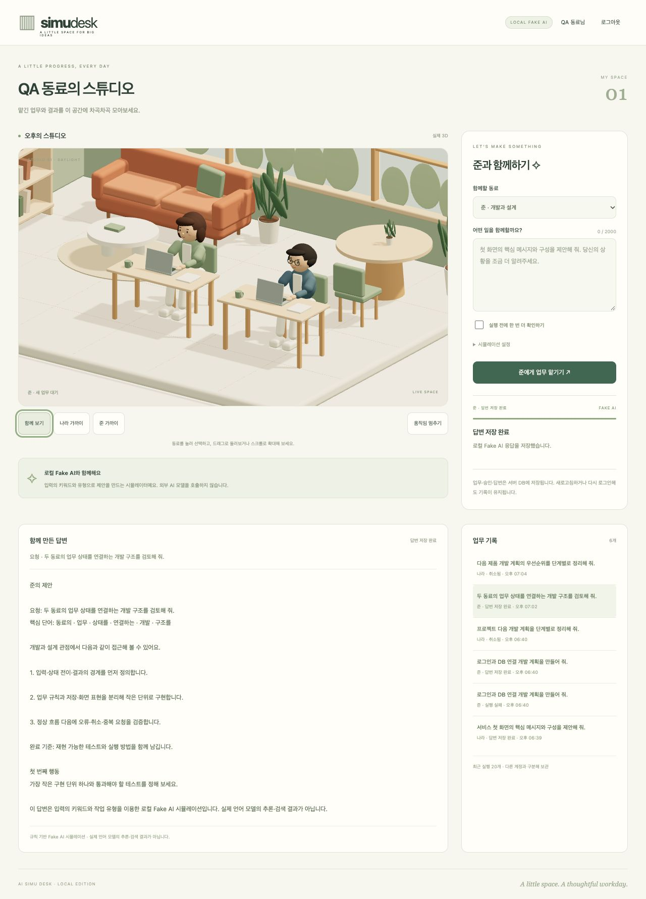
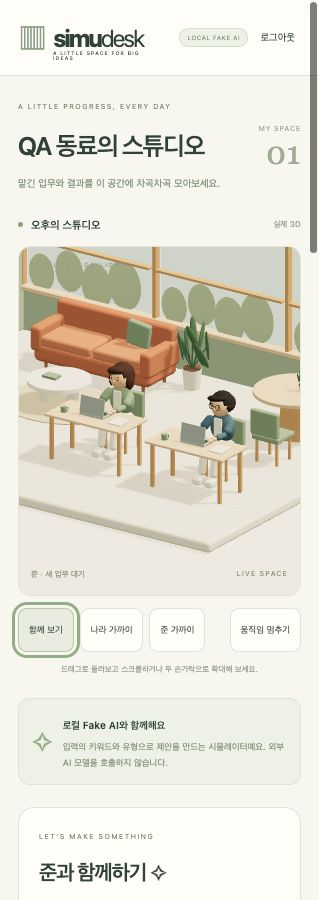
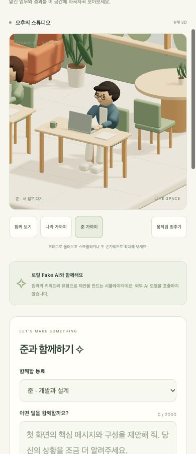

# 나라·준 3D 제품 장면 검증

검증일: 2026-10-19 · macOS / Node.js 22.22.2 / Codex 내장 브라우저.

## 결과
준을 실제 3D 동료로 추가했다. 같은 사무실 안에 나라·준과 각 책상·의자가 놓이며 서버의 활성 실행 담당자만 타이핑한다. 동료 선택·카메라·과거 기록 조회는 업무 담당자를 변경하지 않는다. 로그인·DB·Fake AI 계약은 유지했다.

[제품 열기](http://127.0.0.1:4180/) · [실행 계획](../dev-plan/implement_20261019_185641.md) · [모델 명세](../product/assets/manifest.json).

## 제작과 책임 경계
- `pilot-3d/src/model.mjs`의 선택적 `includeJun`으로 기존 치수를 재사용한다. 준의 짧은 머리·안경·파란 상의를 구분하고 독립 노드 이름·클립을 만든다.
- `product/assets/studio-team-v2.glb`는 자체 절차형 형상이다. 외부 모델·텍스처·모델 다운로드를 사용하지 않았다. Three.js의 MIT 고지는 기존 에셋 폴더에 보존한다.
- v2는 270개 메시, 86,980개 삼각형, 약 3.8MiB다. 미터 단위, Y 위, 바닥 Y=0, 책상 윗면 0.74m·의자 좌면 0.45m를 공유한다.
- 기존 `afternoon-studio-v1.glb`·명세·출처 파일은 바뀌지 않았다. 파일럿은 v1과 기존 `idle/typing` 클립을, 제품은 v2의 동료별 4개 클립을 읽는다.
- 공용 렌더러는 다중 동료의 액션·초점·raycast 선택을 맡는다. `product/src/scene-state.mjs`는 Three/DOM 없이 서버 실행을 동료별 pose로 변환한다.
- `npm run build:product`가 v2 모델을 다시 생성한다. 모델만 갱신할 때는 `npm run build:team`을 사용한다.

## 검증 근거

`npm test` **30개 통과, 실패 0개**. 기존 25개에 실제 v2 GLB 검사 3개와 제품 상태 변환 검사 2개를 추가했다. 타입·JS 문법·의존성 경계, 제품·파일럿 빌드도 통과했다.

| 항목 | 확인 결과 |
| --- | --- |
| 형상·명세 | GLB 실제 재수입, 두 selectable ID·고유 노드 이름·동일 가구 치수·해시 일치 |
| 접지·공간 | 두 작업 공간 경계 상자가 겹치지 않고 0.3m 초과 여유. 총 24개 지지점이 바닥·방 경계 안에 위치 |
| 동작 격리 | 나라/준 각 typing과 상대 idle 혼합에서 담당자 손만 이동. 발과 가구는 고정, 루프 시작/끝 일치 |
| 승인·실행 | 준의 승인 대기에서는 두 idle. 승인 후 `nara_idle + jun_typing` 실제 장면 액션 확인 |
| 소유권 | 준 실행 중 나라 선택 + 나라의 과거 완료 기록 조회에도 준만 typing |
| 조작 | 화면 속 준 클릭으로 선택·초점 변경, 나라 버튼 Enter 키 선택, 동료 드롭다운·함께 보기 정상 동작 |
| 정지·취소 | 나라 실행 중 움직임만 멈춰도 업무는 running. 업무 취소 후 두 idle로 전환 |
| 영속 결과 | 새로고침·모델 오류 복구 후 준의 동일 Run ID·전체 답변 유지 |
| 모델 오류 | 제품 모델을 실제 404로 재현. 대체 화면과 업무 UI 유지, 복원 후 재로드 성공·canvas 하나 유지 |
| 네 화면 너비 | 1280/768/390/319px에서 두 동료 함께 보기, 가로 넘침 없음, 네 장면 조작 버튼 높이 44px |
| v1 회귀 | 새 공용 렌더러로 다시 빌드한 파일럿에서 `idle → typing → 취소 후 idle` 정상 |

확인값: [브라우저 QA JSON](../product/evidence/team-v2/browser-qa.json).

## 한계와 후속 범위
- 두 캐릭터는 앉은 자세의 계층형 노드 애니메이션이다. 인체 스키닝·보행·발화·회의는 포함하지 않는다.
- 모바일 검증은 브라우저 뷰포트 기준이며 실제 휴대폰의 장시간 GPU 성능이나 운영 동시 사용자 부하는 측정하지 않았다.
- Fake AI는 기존 규칙 기반 응답을 유지한다. 공개 배포·메일 계정 복구·운영 PostgreSQL·공동 공간·외부 LLM은 별도 후속 작업이다.
